# Notes from Dijkstra's Retirement Symposium — "In Pursuit of Simplicity"

*University of Texas at Austin, May 12–13, 2000*


While moving recently, I found my notebook containing the notes that I took while attending Professor Dijkstra's Retirement Symposium *In Pursuit of Simplicity*. (Note that one of the speakers and author of [Edsger Dijkstra The Man Who Carried Computer Science on His Shoulders](https://arxiv.org/pdf/2010.00506) Krzysztof R. Apt refers to it as a 70th birthday celebration, but I remember it as a retirement symposium (and that is what I captured in my notes), so I will continue to call it that. The symposium was open to everyone and so, although my days as a student were behind me and I was working full time, I took the opportunity to meet my heros (or at least see them in person) and attend the event. It was a remarkable event.

I find it interesting to look back at these notes. NOTE: ALL errors were introduced by me. A few things stand out to me as especially at this time as the profession wrestles with AI coding and the tsunami of vulnerabilities.
-  Dijkstra: "Can a computer scientist save the computing industry? — NO"
-  Dijkstra: "Widely spread belief that once we had a sufficiently powerful programming language, anyone could program"
-  Hoare: "A program and its correctness proof grow hand in hand"
-  Dijkstra: [A programs correctness can be asserted by] "Faith or proof or exhaustive testing"

I will lean on R. Dijkstra's observation "**Lesson: be respectful of trivial insights** their lack of depth doesn't reflect on their importance" from the symposium to say that once upon a time there was little enough code to conceive of the possibility of being able to exhaustively test it all. It has been decades since that was the case. If we don't seize this moment in time to lean on formal verification of critical code to stem the tide of today's AI vulnerability apocalypse, then we really never will. And that will be on all of us. We have a fresh chance. That means that even though this seminar happened so long ago, it is so very timely right now.

The papers that the talks were based on were gathered and published in IPL Volumn 77, Issue 2 [Special issue In honor of Edsger W. Dijkstra (Dijkstra)](https://www.sciencedirect.com/journal/information-processing-letters/vol/77/issue/2) edited by Vicki L. Almstrum, David Gries. It is available by subscription only, so I have not read it but if you are interested in these topics and have the spare cash, I recommend it to you.

Additional resources on this topic:
- [2021 Commemoration](https://arxiv.org/pdf/2104.03392)
- [Dijkstra's UT homepage](https://www.cs.utexas.edu/~EWD/)


I used AI to transcribe my notes from the handwritten scanned images into text for your convenience and went back to check the results. In some cases, names and titles were corrected versus what I captured based on information about the event. 

---

## Day 1 — May 12, 2000

<!-- page 01 -->
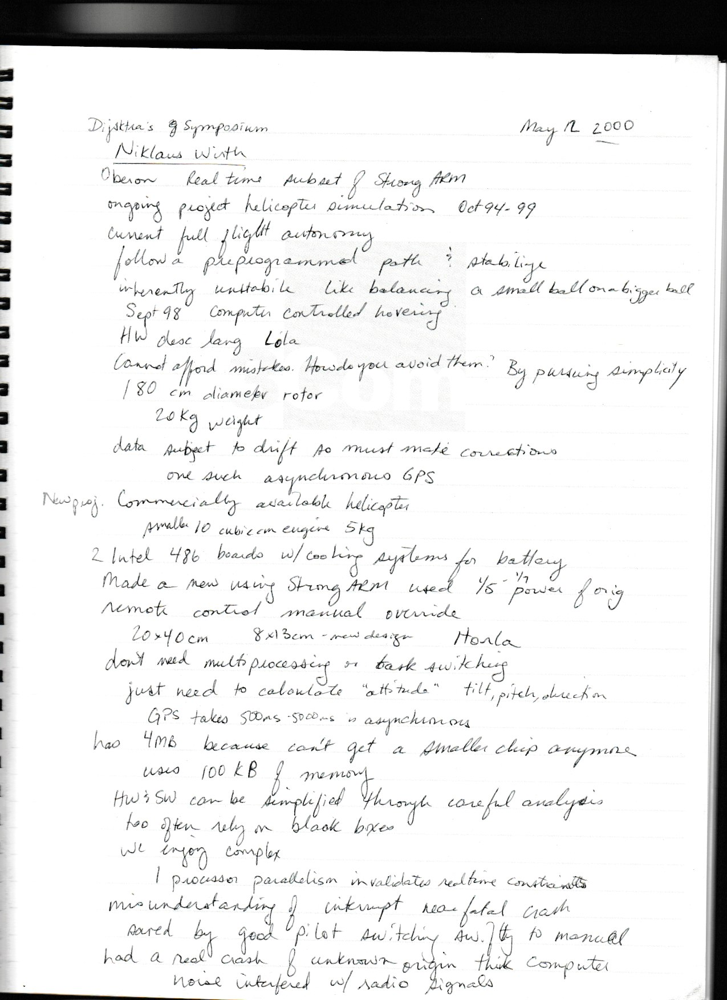

### Niklaus Wirth

- Oberon — real time subset of StrongARM
- Ongoing project: helicopter simulation, Oct '94–'99
- Current: full flight autonomy
  - follow a preprogrammed path & stabilize
  - inherently unstable, like balancing a small ball on a bigger ball
- Sept '98: computer controlled hovering
- HW description language: Lola
- Cannot afford mistakes. How do you avoid them? **By pursuing simplicity.**
- 180 cm diameter rotor
  - 20 kg weight
- Data subject to drift, so must make corrections
  - one such: asynchronous GPS
- New project: commercially available helicopter
  - smaller 10 cubic cm engine, 5 kg
- 2 Intel 486 boards w/ cooling systems for battery
- Made a new one using StrongARM; used 1/5–1/7 power of original
- Remote control manual override
- 20×40 cm → 8×13 cm — new design, "Horla"
- Don't need multiprocessing or task switching
  - just need to calculate "attitude": tilt, pitch, direction
  - GPS takes 500 ms–5000 ms, is asynchronous
- Has 4 MB because can't get a smaller chip anymore
  - uses 100 KB of memory
- HW & SW can be simplified through careful analysis
- Too often rely on black boxes
- We enjoy complex
  - 1-processor parallelism invalidates realtime constraints
- Misunderstanding of interrupt → near fatal crash
  - saved by good pilot switching swiftly to manual
- Had a real crash of unknown origin; think computer noise interfered w/ radio signals

<!-- page 02 -->
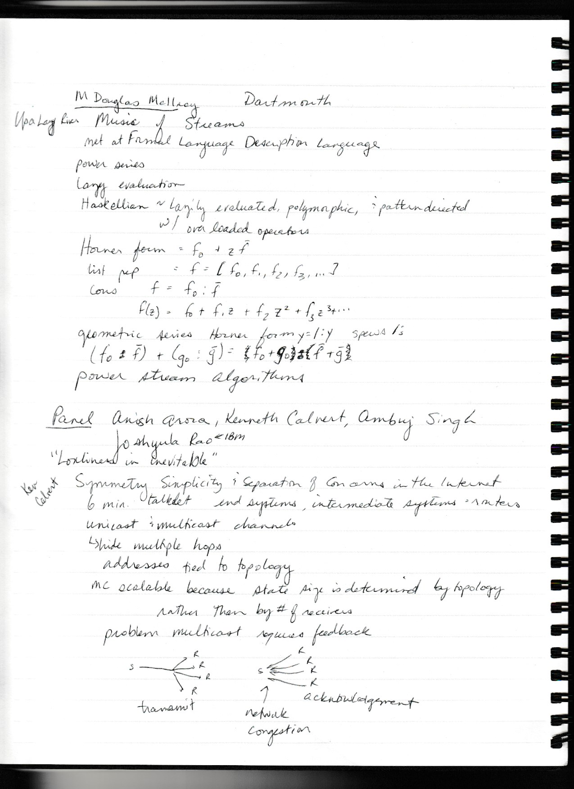

### M. Douglas McIlroy — Dartmouth

**"Up a Lazy River" / Music of Streams**

- Met at Formal Language Description Language [conference]
- Power series
- Lazy evaluation
- Haskellian ≈ lazily evaluated, polymorphic, & pattern directed, w/ overloaded operators
- Horner form: $f = f_0 + z\bar{f}$
- List rep: $f = [f_0, f_1, f_2, f_3, \ldots]$
- Cons: $f = f_0 : \bar{f}$
- $f(z) = f_0 + f_1 z + f_2 z^2 + f_3 z^3 + \cdots$
- Geometric series in Horner form: `y = 1:y` spews 1's
- $(f_0 : \bar{f}) + (g_0 : \bar{g}) = (f_0 + g_0) : (\bar{f} + \bar{g})$
- Power stream algorithms

### Panel — Anish Arora, Kenneth Calvert, Ambuj Singh, Josyula Rao (IBM)

*"Loneliness is inevitable"*

#### Ken Calvert — Symmetry, Simplicity & Separation of Concerns in the Internet

- 6 min. talklet
- End systems, intermediate systems = routers
- Unicast & multicast channels
  - hide multiple hops
  - addresses tied to topology
- MC (multicast) scalable because state size is determined by topology rather than by # of receivers
- Problem: multicast requires feedback

```
Transmit:                    Acknowledgement:

         ┌──→ R              R ──┐
  S ─────┼──→ R              R ──┤
         ├──→ R              R ──┼──→ S   ← network congestion
         └──→ R              R ──┘
```

<!-- page 03 -->
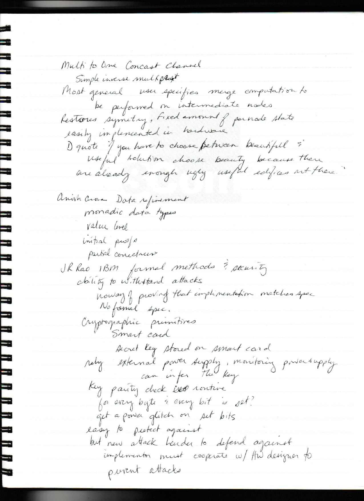

- Multi-to-One **Concast** Channel
  - simple inverse multicast
- Most general: user specifies merge computation to be performed on intermediate nodes
- Restores symmetry; fixed amount of per-node state
- Easily implemented in hardware
- D quote: *"If you have to choose between a beautiful & a useful solution, choose beauty, because there are already enough ugly useful edifices out there."*

#### Anish Arora — Data Refinement

- Monadic data types
- Value level
- Initial proofs
- Partial correctness

#### J. R. Rao (IBM) — Formal Methods & Security

- Ability to withstand attacks
  - no way of proving that implementation matches spec
  - no formal spec
- Cryptographic primitives
  - smart card
    - secret key stored on smart card
- Rely on external power supply; by monitoring power supply, can infer the key
- Key parity check routine
  - for every byte & every bit: is it set?
  - get a power glitch on set bits
- Easy to protect against
- But new attacks harder to defend against
  - implementor must cooperate w/ HW designer to prevent attacks

<!-- page 04 -->
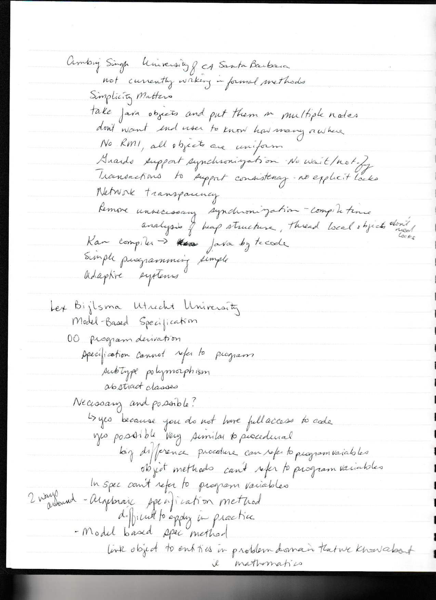

#### Ambuj Singh — University of California, Santa Barbara

- Not currently working in formal methods
- **Simplicity Matters**
- Take Java objects and put them on multiple nodes
- Don't want end user to know how many or where
- No RMI; all objects are uniform
- Guards support synchronization — no wait/notify
- Transactions to support consistency — no explicit locks
- Network transparency
- Remove unnecessary synchronization — compile-time analysis of heap structure; thread-local objects don't need locks
- Kan compiler → Java bytecode
- Simple programming, simple
- Adaptive systems

### Lex Bijlsma — Utrecht University

**Model-Based Specification**

- OO program derivation
  - specification cannot refer to program
    - subtype polymorphism
    - abstract classes
- Necessary and possible?
  - ↳ yes (necessary), because you do not have full access to code
  - yes possible, very similar to procedural
    - big difference: procedure can refer to program variables
    - object methods can't refer to program variables
  - in spec, can't refer to program variables
- 2 ways around:
  - Algebraic specification method
    - difficult to apply in practice
  - Model-based spec method
    - link object to entities in problem domain that we know about, i.e. mathematics

<!-- page 05 -->
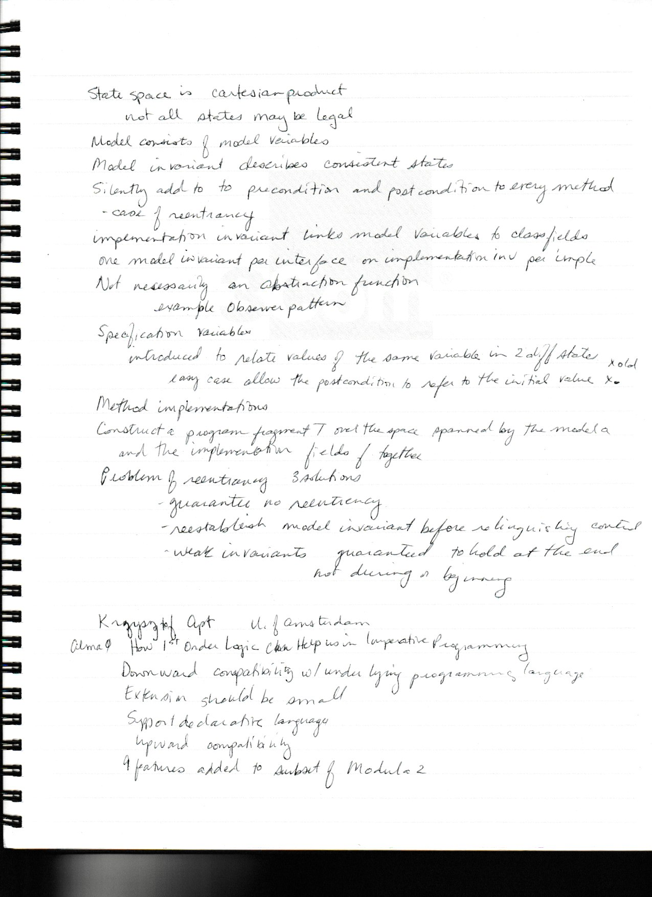

- State space is Cartesian product
  - not all states may be legal
- Model consists of model variables
- Model invariant describes consistent states
- Silently add [it] to precondition and postcondition of every method
  - case of reentrancy
- Implementation invariant links model variables to class fields
- One model invariant per interface, one implementation invariant per implementation
- Not necessarily an abstraction function
  - example: Observer pattern
- Specification variables
  - introduced to relate values of the same variable in 2 different states ($x_{old}$)
    - easy case: allow the postcondition to refer to the initial value $x_0$
- Method implementations
- Construct a program fragment $T$ over the space spanned by the model $a$ and the implementation fields $f$ together
- Problem of reentrancy — 3 solutions:
  - guarantee no reentrancy
  - reestablish model invariant before relinquishing control
  - weak invariants: guaranteed to hold at the end, not during or at beginning

### Krzysztof Apt — University of Amsterdam

**(Alma-0) How First-Order Logic Can Help Us in Imperative Programming**

- Downward compatibility w/ underlying programming language
- Extension should be small
- Support declarative language
- Upward compatibility
- 9 features added to subset of Modula-2

<!-- page 06 -->
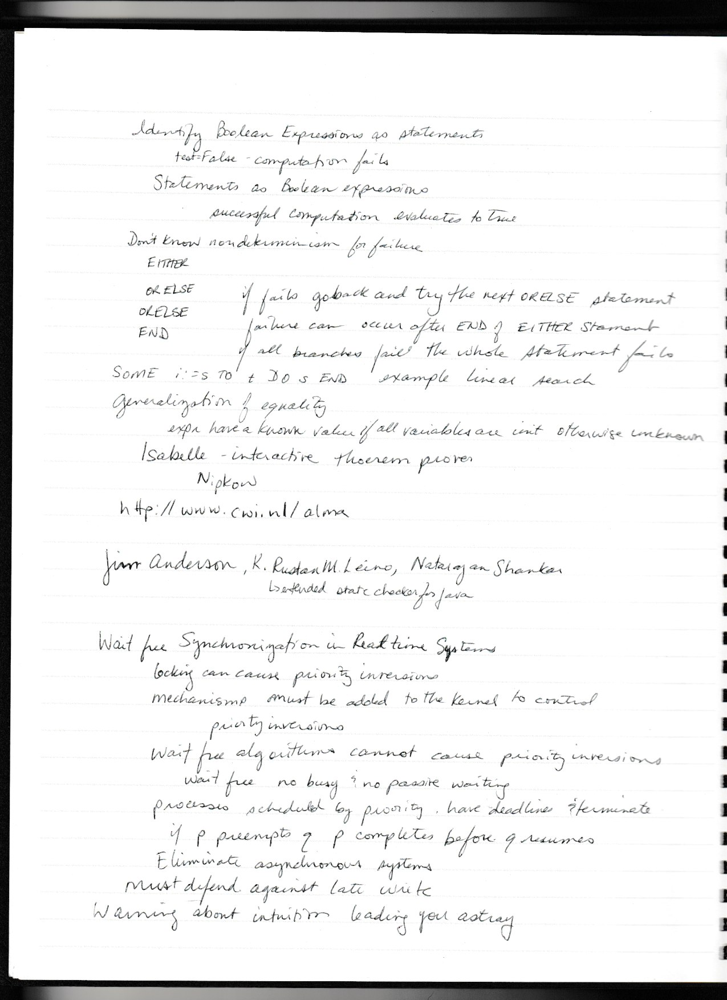

- Identify Boolean expressions as statements
  - test = False → computation fails
- Statements as Boolean expressions
  - successful computation evaluates to true
- Don't know nondeterminism for failure

```
EITHER
  ...
ORELSE
  ...
ORELSE
  ...
END
```

- If [the first `ORELSE`] fails, go back and try the next `ORELSE` statement
  - failure can occur after `END` of `EITHER` statement
  - if all branches fail, the whole statement fails
- `SOME i := s TO t DO S END` — example: linear search
- Generalization of equality
  - expressions have a known value if all variables are initialized, otherwise unknown
- Isabelle — interactive theorem prover
  - Nipkow
- http://www.cwi.nl/alma

### Panel — Jim Anderson, K. Rustan M. Leino, Natarajan Shankar

*(Leino: ↳ Extended Static Checker for Java)*

#### Jim Anderson — Wait-Free Synchronization in Real-Time Systems

- Locking can cause priority inversions
- Mechanisms must be added to the kernel to control priority inversions
- Wait-free algorithms cannot cause priority inversions
  - wait free: no busy & no passive waiting
- Processes scheduled by priority, have deadlines & terminate
  - if $p$ preempts $q$, $p$ completes before $q$ resumes
- Eliminate asynchronous systems
- Must defend against late write
- Warning about intuition leading you astray

<!-- page 07 -->
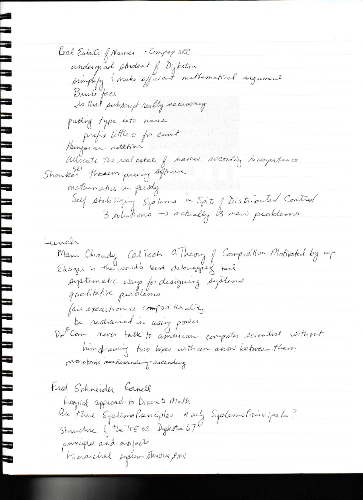

#### Rustan Leino — Real Estate of Names (Compaq SRC)

- Undergrad student of Dijkstra
- Simplify & make efficient mathematical argument
- Brute force
- Is that subscript really necessary?
- Putting type into name
  - prefix little `c` for count
- Hungarian notation
- Allocate the real estate of names according to importance

#### Natarajan Shankar (SRI) — Theorem Proving Software

- Mathematics in parody
- *Self-Stabilizing Systems in Spite of Distributed Control*
  - 3 solutions → actually 3 new problems

### *Lunch*

### Mani Chandy — Caltech

**A Theory of Composition Motivated by wp**

- Edsger is the world's best debugging tool
- Systematic ways for designing systems
- Qualitative problems
- Fair execution vs. compositionality
  - be restrained in using power
- D quote: *Can never talk to an American computer scientist without him drawing two boxes with an arrow between them.*
- Monotonic: nondescending ≈ ascending

### Fred Schneider — Cornell

- *A Logical Approach to Discrete Math*
- **Are There Systems Principles or Only Systems Principals?**
- *Structure of the THE OS*, Dijkstra '67
- Principles and artifacts
- Hierarchical system structure, PMV

<!-- page 08 -->
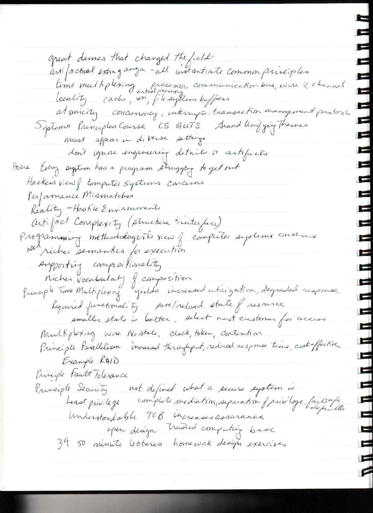

- Great demos that changed the field
- Artifactual extravaganza — all instantiate common principles
  - time multiplexing: processor, communication bus, wire & channel
  - locality: cache, VM (virtual memory), file system buffers
  - atomicity: concurrency, interrupts, transaction management protocols
- Systems Principles course: **CS GUTS** — Grand Unifying Themes
  - must appear in diverse settings
  - don't ignore engineering details or artifacts
- Hoare: *Every system has a program struggling to get out*
- Hacker's view of computer systems concerns:
  - Performance mismatches
  - Reality ≈ hostile environments
  - Artifact complexity (structure & interface)
- Programming methodologist's view of computer systems concerns:
  - need richer semantics for execution
  - supporting compositionality
  - richer vocabulary of composition
- **Principle: Time Multiplexing** — yields increased utilization, degraded response
  - required functionality: save/reload state of resource
    - smaller state is better; select next customer for access
  - multiplexing wire: no state, clock, token, contention
- **Principle: Parallelism** — increased throughput, reduced response time, cost effective
  - example: RAID
- **Principle: Fault Tolerance**
- **Principle: Security** — not defined what a secure system is
  - least privilege, complete mediation, separation of privilege, failsafe defaults
  - understandable TCB increases assurance
    - open design; trusted computing base
- 39 50-minute lectures; homework design exercises

<!-- page 09 -->
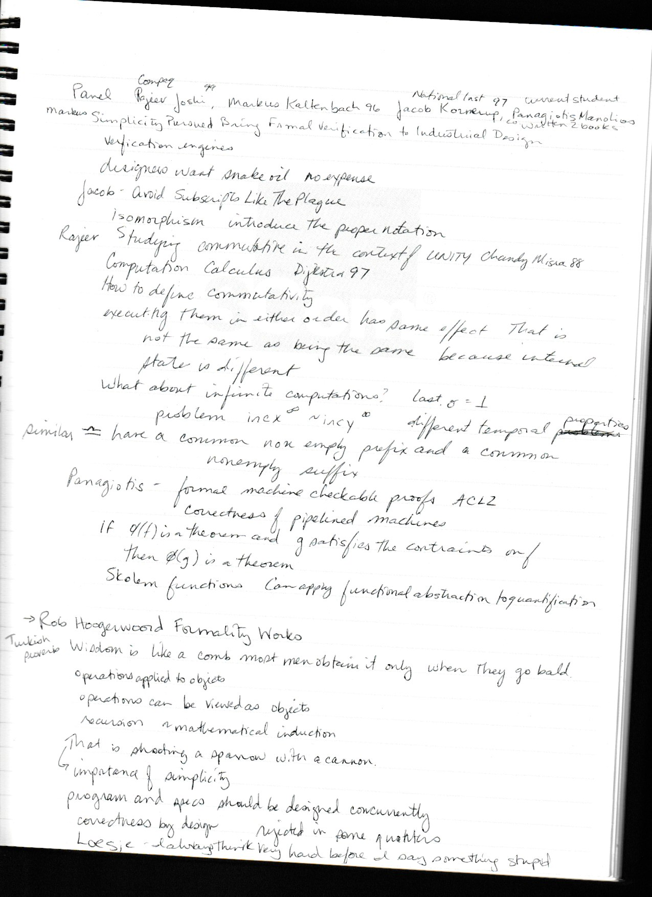

### Panel — Rajeev Joshi (Compaq, '99), Markus Kaltenbach ('96), Jacob Kornerup (National Instruments, '97), Panagiotis Manolios (current student; co-written 2 books)

#### Markus Kaltenbach — Simplicity Pursued: Bringing Formal Verification to Industrial Design

- Verification engines
- Designers want snake oil, no expense

#### Jacob Kornerup — Avoid Subscripts Like the Plague

- Isomorphism: introduce the proper notation

#### Rajeev Joshi 

- Studying Commutativity in the context of UNITY (Chandy & Misra '88)
- Computation Calculus (Dijkstra '97)
- How to define commutativity?
  - executing them in either order has same effect. That is not the same as being the same, because internal state is different
- What about infinite computations? $\mathit{last}.\sigma = \bot$
  - problem: $\mathit{incx}^\infty \sim \mathit{incy}^\infty$ — different temporal properties
- Similar ($\simeq$): have a common nonempty prefix and a common nonempty suffix

#### Panagiotis Manolios — Formal Machine-Checkable Proofs (ACL2)

- Correctness of pipelined machines
- If $\varphi(f)$ is a theorem and $g$ satisfies the constraints on $f$, then $\varphi(g)$ is a theorem
- Skolem functions: can apply functional abstraction to quantification

### Rob Hoogerwoord — Formality Works

- Turkish proverb: *Wisdom is like a comb; most men obtain it only when they go bald.*
- Operations applied to objects
- Operations can be viewed as objects
- Recursion ≈ mathematical induction
- ↳ *That is shooting a sparrow with a cannon.*
  - importance of simplicity
- Program and specs should be designed concurrently
- Correctness by design — rejected in some quarters
- Loesje: *I always think very hard before I say something stupid*

<!-- page 10 -->
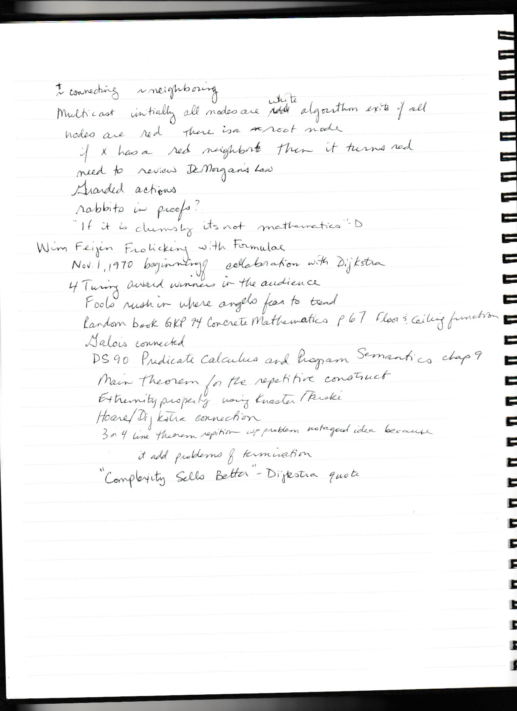

- ∓ [?] connecting ≈ neighboring
- Multicast: initially all nodes are white; algorithm exits if all nodes are red; there is a root node
  - if $x$ has a red neighbor, then it turns red
- Need to review De Morgan's Law
- Guarded actions
- Rabbits in proofs?
- *"If it is clumsy, it's not mathematics."* — D

### Wim Feijen — Frolicking with Formulae

- Nov. 1, 1970: beginning of collaboration with Dijkstra
- 4 Turing Award winners in the audience
  - *Fools rush in where angels fear to tread*
- Random book: GKP '94 *Concrete Mathematics*, p. 67, floor & ceiling functions
  - Galois connected
- DS90 *Predicate Calculus and Program Semantics*, chap. 9
  - Main theorem for the repetitive construct
  - Extremity property using Knaster/Tarski
- Hoare/Dijkstra connection
- 3- or 4-line theorem: repetition wp problem — not a good idea because it adds problems of termination
- *"Complexity sells better."* — Dijkstra quote

---

## Day 2 — May 13, 2000

<!-- page 11 -->
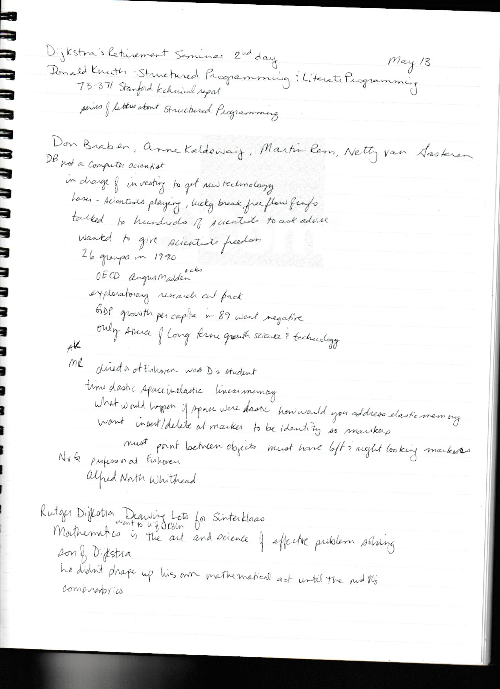

### Donald Knuth — Structured Programming & Literate Programming

- 73-371 Stanford technical report
- Series of letters about structured programming

### Panel — Don Braben, Anne Kaldewaij, Martin Rem, Netty van Gasteren

#### Don Braben

- Not a computer scientist
- In charge of investing to get new technology
- Laser — scientists playing, lucky break, free flow of info
- Talked to hundreds of scientists to ask advice
  - wanted to give scientists freedom
  - 26 groups in 1990
- OECD, Angus Maddison
  - exploratory research cut back
  - GDP growth per capita in '89 went negative
  - only source of long-term growth: science & technology

#### Anne Kaldewaij

*(no notes)*

#### Martin Rem

- Director at Eindhoven; was D's student
- Time elastic, space inelastic — linear memory
  - what would happen if space were elastic? How would you address elastic memory?
  - want insert/delete at marker to be identity, so markers must point between objects; must have left- & right-looking markers

#### Netty van Gasteren

- Professor at Eindhoven
- Alfred North Whitehead

### Rutger Dijkstra — Drawing Lots for Sinterklaas

- Went to U. of Köln
- *Mathematics is the art and science of effective problem solving*
- Son of Dijkstra
- He didn't shape up his own mathematical act until the mid '80s
- Combinatorics

<!-- page 12 -->
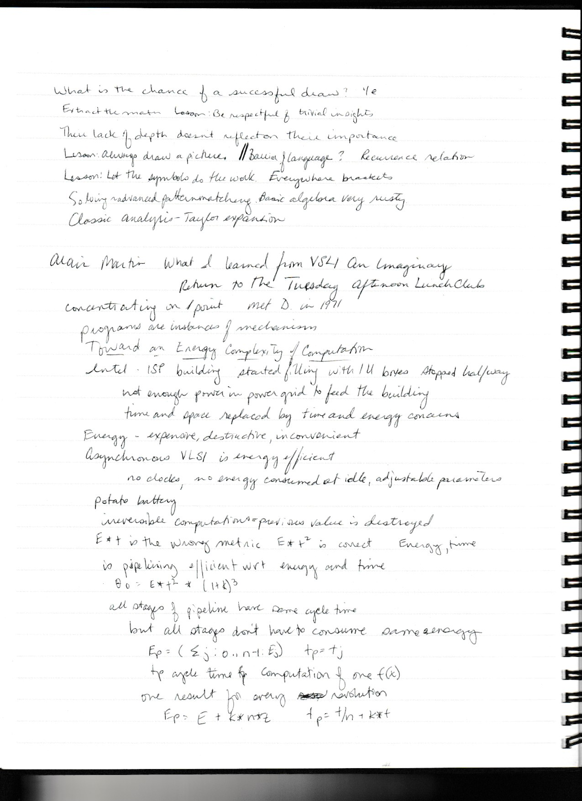

- What is the chance of a successful draw? $1/e$
- Extract the math. **Lesson: be respectful of trivial insights**
  - their lack of depth doesn't reflect on their importance
- **Lesson: always draw a picture.** // Barrier of language? Recurrence relation
- **Lesson: let the symbols do the work.** Everywhere brackets
- Solving: advanced pattern matching. Basic algebra very rusty
- Classic analysis — Taylor expansion

### Alain Martin — What I Learned from VLSI: An Imaginary Return to the Tuesday Afternoon Lunch Club

- Concentrating on 1 point; met D. in 1971
- Programs are instances of mechanisms
- *Toward an Energy Complexity of Computation*
- Intel: ISP building started filling with 1U boxes, stopped halfway
  - not enough power in power grid to feed the building
  - time and space replaced by time and energy concerns
- Energy — expensive, destructive, inconvenient
- Asynchronous VLSI is energy efficient
  - no clocks, no energy consumed at idle, adjustable parameters
- Potato battery
- Irreversible computations = previous value is destroyed
- $E \cdot t$ is the wrong metric; $E \cdot t^2$ is correct (energy, time)
- Is pipelining efficient w.r.t. energy and time?
  - $\Theta_0 = E \cdot t^2 \cdot (1+k)^3$ [?]
- All stages of pipeline have same cycle time
  - but all stages don't have to consume same energy
  - $E_p = (\Sigma j : 0..n-1 : E_j) \qquad t_p = t_j$
  - $t_p$: cycle time for computation of one $f(x)$
  - one result for every revolution
  - $E_p = E + k \cdot n \cdot E$ [?] $\qquad t_p = t/n + k \cdot t$

<!-- page 13 -->
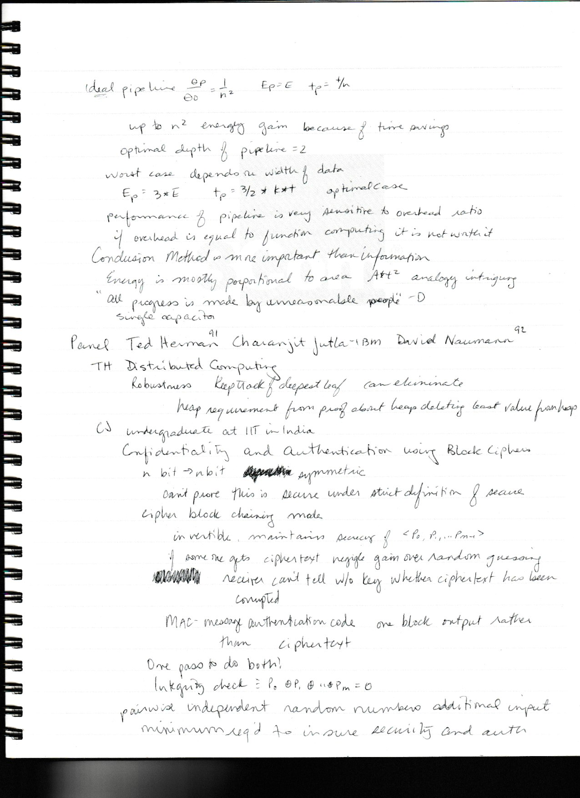

- Ideal pipeline: $\dfrac{\Theta_p}{\Theta_0} = \dfrac{1}{n^2} \qquad E_p = E \qquad t_p = t/n$
  - up to $n^2$ energy gain because of time savings
- Optimal depth of pipeline = 2
  - worst case depends on width of data
  - $E_p = 3E \qquad t_p = \tfrac{3}{2} \cdot k \cdot t$ — optimal case
- Performance of pipeline is very sensitive to overhead ratio
  - if overhead is equal to function computing, it is not worth it
- **Conclusion: method is more important than information**
- Energy is mostly proportional to area — $A \cdot t^2$ analogy intriguing
- *"All progress is made by unreasonable people."* — D
- Single capacitor

### Panel — Ted Herman ('91), Charanjit Jutla (IBM), David Naumann ('92)

#### Ted Herman — Distributed Computing

- Robustness: keep track of deepest leaf — can eliminate heap requirement from proof about heap deleting least value from heap

#### Charanjit Jutla — Confidentiality and Authentication Using Block Ciphers

- Undergraduate at IIT in India
- $n$ bit → $n$ bit, symmetric
  - can't prove this is secure under strict definition of secure
- Cipher block chaining mode
  - invertible; maintains secrecy of $\langle P_0, P_1, \ldots, P_{m-1} \rangle$
  - if someone gets ciphertext, negligible gain over random guessing
  - receiver can't tell w/o key whether ciphertext has been corrupted
- MAC — message authentication code: one block output rather than ciphertext
- **One pass to do both!**
  - integrity check: $P_0 \oplus P_1 \oplus \cdots \oplus P_m = 0$
- Pairwise independent random numbers as additional input
  - minimum required to ensure security and authentication

<!-- page 14 -->
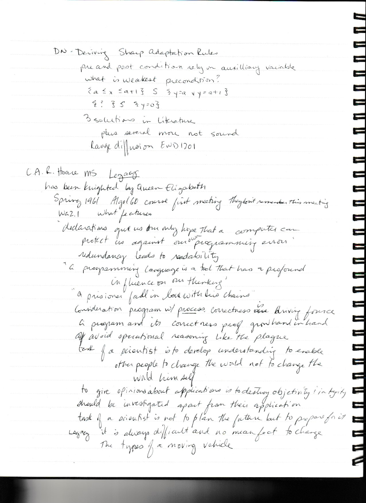

#### David Naumann — Deriving Sharp Adaptation Rules

- Pre- and postcondition rely on auxiliary variable
- What is weakest precondition?

$$\{a \le x \le a+1\}\ S\ \{y = a \lor y = a+1\}$$

$$\{\,?\,\}\ S\ \{y = 0\}$$

- 3 solutions in literature
  - plus several more not sound
- Range diffusion: EWD1201

### C. A. R. Hoare (MS) — Legacy

- Has been knighted by Queen Elizabeth
- Spring 1961: Algol 60 course, first meeting; they don't remember this meeting
- WG2.1: what features
- *"Declarations give us our only hope that a computer can protect us against our own programming errors"*
- Redundancy leads to readability
- *"A programming language is a tool that has a profound influence on our thinking"*
- *"A prisoner falls in love with his chains"*
- Consideration of program w/ *process*: correctness is driving force
- A program and its correctness proof grow hand in hand
- Avoid operational reasoning like the plague
- Task of a scientist is to develop understanding to enable other people to change the world, not to change the world himself
- To give opinions about applications is to destroy objectivity & integrity
  - should be investigated apart from their application
- Task of a scientist is not to plan the future but to prepare for it
- Legacy: it is always difficult and no mean feat to change the tyres of a moving vehicle

<!-- page 15 -->
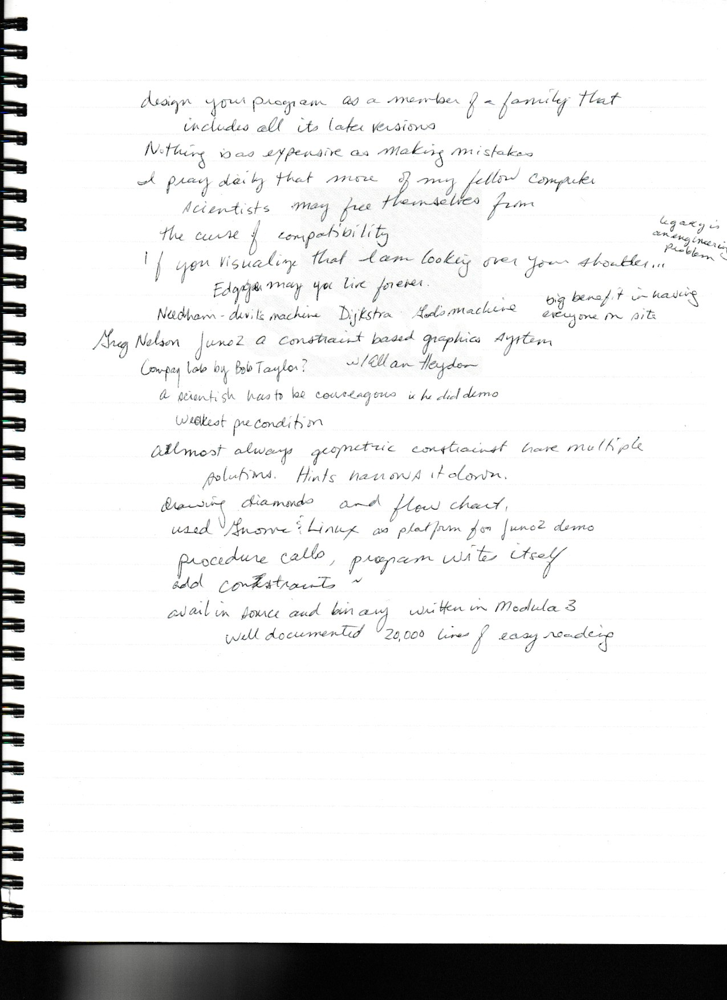

- Design your program as a member of a family that includes all its later versions
- Nothing is as expensive as making mistakes
- *"I pray daily that more of my fellow computer scientists may free themselves from the curse of compatibility"*
  - *(margin: legacy is an engineering problem)*
- If you visualize that I am looking over your shoulder…
  - Edsger, may you live forever.
- Needham — devil's machine; Dijkstra — God's machine
  - big benefit in having everyone on site

### Greg Nelson — Juno-2, a Constraint-Based Graphics System

- Compaq lab by Bob Taylor? w/ Allan Heydon
- A scientist has to be courageous — he did a demo
- Weakest precondition
- Almost always, geometric constraints have multiple solutions. Hints narrow it down.
- Drawing diamonds and flow chart
- Used GNOME & Linux as platform for Juno-2 demo
- Procedure calls; program writes itself
- Add constraints ~
- Available in source and binary; written in Modula-3
  - well documented, 20,000 lines of easy reading

<!-- page 16 -->
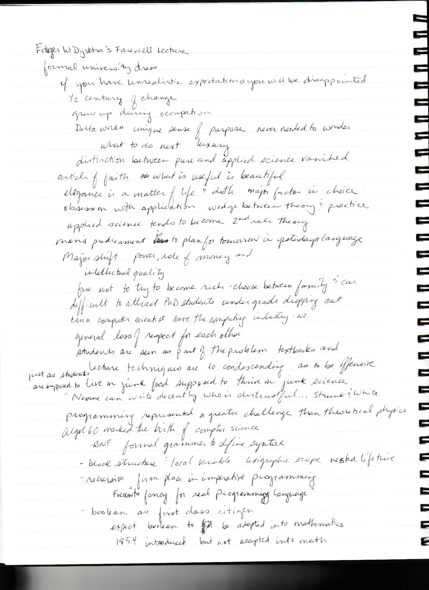

### Edsger W. Dijkstra's Farewell Lecture

- Formal university dress
- If you have unrealistic expectations, you will be disappointed
- ½ century of change
- Grew up during occupation
- Delta Works: unique sense of purpose; never needed to wonder what to do next — luxury
- Distinction between pure and applied science vanished
- Article of faith: what is useful is beautiful
- Elegance is a matter of life & death; major factor in choice
- Obsession with application: wedge between theory & practice
- Applied science tends to become 2nd-rate theory
- Man's predicament is to plan for tomorrow in yesterday's language
- Major shift: power, role of money, and intellectual quality
- Free not to try to become rich — choose between family & car
- Difficult to attract PhD students; undergrads dropping out
- Can a computer scientist save the computing industry? — NO
- General loss of respect for each other
- Students are seen as part of the problem; textbooks and lecture techniques are so condescending as to be offensive
  - just as students are supposed to live on junk food, [they are] supposed to thrive on junk science
- *"No one can write decently who is distrustful…"* — Strunk & White
- Programming represented a greater challenge than theoretical physics
- **Algol 60 marked the birth of computer science**
  - BNF: formal grammar to define syntax
  - block structure: local variables, lexicographic scope, nested lifetime
  - recursion: firm place in imperative programming
    - Fortran "too fancy for real programming language"
  - boolean as first-class citizen
    - expect boolean to be adopted into mathematics
    - 1854 introduced, but not accepted into math

<!-- page 17 -->
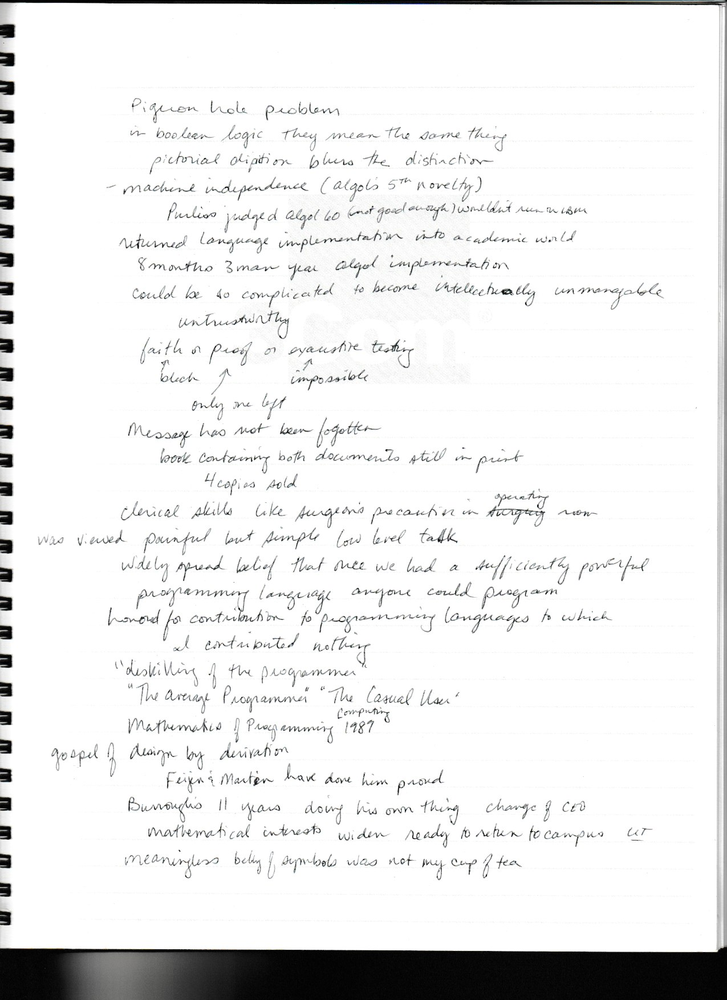

- Pigeonhole problem
  - in boolean logic they mean the same thing
  - pictorial depiction blurs the distinction
- Machine independence (Algol's 5th novelty)
  - Purliss judged Algol 60 (not good enough) — wouldn't run on IBM
- Returned language implementation into academic world
  - 8 months, 3 man-year Algol implementation
- Could be so complicated as to become intellectually unmanageable, untrustworthy
- Faith or proof or exhaustive testing
  - faith: blech
  - exhaustive testing: impossible
  - proof: only one left
- Message has not been forgotten
  - book containing both documents still in print
    - 4 copies sold
- Clerical skills, like surgeon's precautions in operating room
  - was viewed as painful but simple low-level task
- Widely spread belief that once we had a sufficiently powerful programming language, anyone could program
- Honored for contribution to programming languages, to which I contributed nothing
- "Deskilling of the programmer"
- "The Average Programmer," "The Casual User"
- *Mathematics of Programming* Computing 1987
- Gospel of design by derivation
  - Feijen & Martin have done him proud
- Burroughs: 11 years doing his own thing; change of CEO
- Mathematical interests widen; ready to return to campus — UT
- Meaningless belly [?] of symbols was not my cup of tea

<!-- page 18 -->
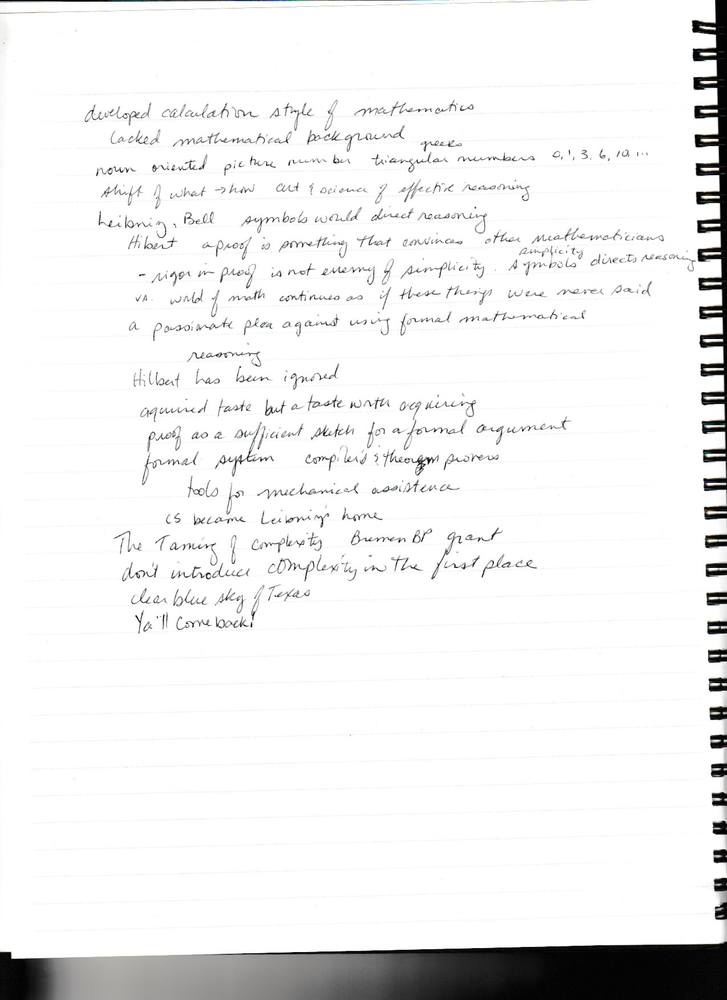

- Developed calculational style of mathematics
- Lacked mathematical background
- Noun-oriented picture number (Greeks): triangular numbers $0, 1, 3, 6, 10, \ldots$
- Shift of *what* → *how*: art & science of effective reasoning
- Leibniz, Bell: symbols would direct reasoning
- Hilbert: a proof is something that convinces other mathematicians
  - rigor in proof is not enemy of simplicity; symbols' simplicity directs reasoning
  - vs. world of math continues as if these things were never said
  - a passionate plea against using formal mathematical reasoning
- Hilbert has been ignored
- Acquired taste, but a taste worth acquiring
- Proof as a sufficient sketch for a formal argument
- Formal systems: compilers & theorem provers
  - tools for mechanical assistance
- CS became Leibniz's home
- *The Taming of Complexity* — Bremen, BP grant
- Don't introduce complexity in the first place
- Clear blue sky of Texas
- **Y'all come back!**
